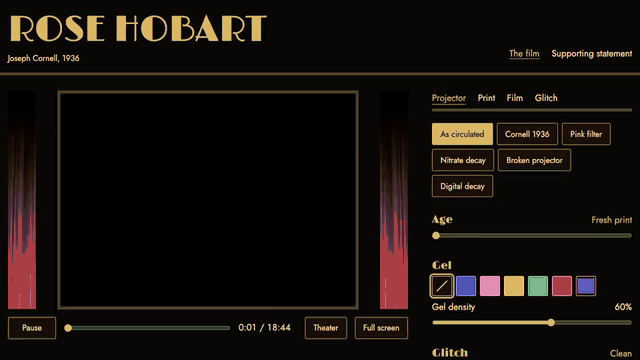

# Rose Hobart

[](https://rosehobart.joekarlsson.com/)
[](https://github.com/JoeKarlsson/rose-hobart/actions/workflows/ci.yml)



Every time Joseph Cornell screened *Rose Hobart*, it could come out a little
different, and the version almost everyone watches now is one of those
screenings, frozen. This gives the projector back to whoever is watching: pick
the gel, the speed and the music, and age the film like old nitrate or glitch it
like a file copied too many times.

[Watch it at rosehobart.joekarlsson.com](https://rosehobart.joekarlsson.com) ·
[Read the full statement](https://www.joekarlsson.com/work/rose-hobart/)

## Quick start

Node 22.12 or later.

```sh
git clone https://github.com/JoeKarlsson/rose-hobart.git
cd rose-hobart
npm install
npm run dev               # http://localhost:4321
```

## Development

```sh
npm test                  # unit tests (Vitest)
npx playwright install chromium webkit
npm run test:e2e          # browser tests against the built site
npm run test:visual       # screenshot tests in Playwright's Linux image (needs Docker)
node tools/render-images.mjs   # re-render icons and share images after changing them
```

The theater in `src/theater/` is plain TypeScript. `renderer.ts` draws each
video frame through one WebGL2 fragment shader (`shaders.ts`), and `effects.ts`
is the single table of controls that the panel, the presets and the shader
uniforms all read. Music lives in `tracks.ts`. Keep flicker under 15%
brightness swing and tears at two a second or fewer (WCAG 2.3.1).

CI tests every push. To deploy, run the CI workflow by hand
(`gh workflow run ci.yml`); it publishes to the `gh-pages` branch only after the
tests pass. GitHub Pages can't set response headers, so the CSP is a `<meta>`
tag.

## Credits

Made with my sister, Laurel Karlsson. The joint 2017 supporting statement is on the site's [Statements page](https://rosehobart.joekarlsson.com/about).

The records are 78s released in 1925 or earlier, from the Internet Archive's Great 78 Project,
credited on the About page. The velvet curtain photo is CC0
([Wikimedia Commons](https://commons.wikimedia.org/wiki/File:Curtain-939464.jpg)).
The Fox Theatre, Brooklyn photograph is from the Historic American Buildings
Survey (public domain). Fonts: Limelight and Jost (SIL Open Font License).

## License

MIT. See [LICENSE](LICENSE).
